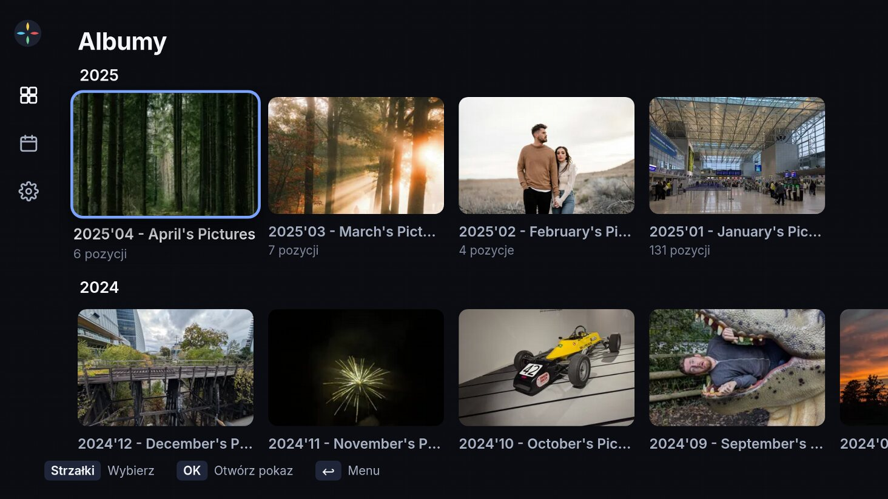
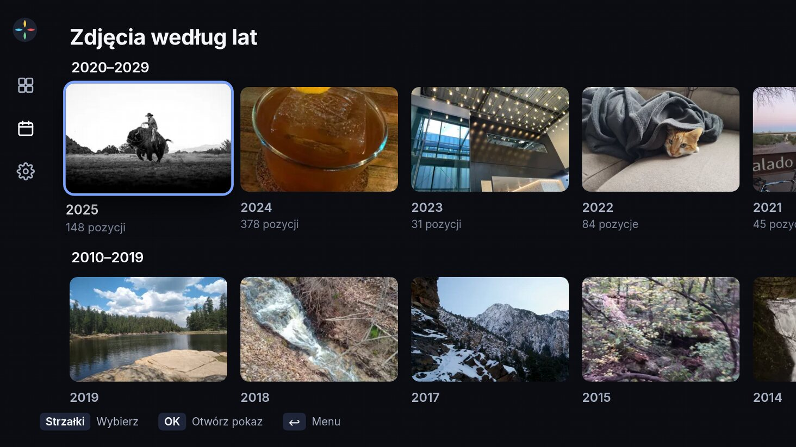
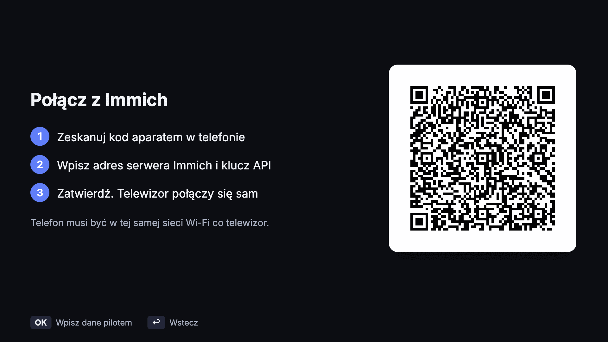

# Immich TV for Samsung (Tizen)

[](https://github.com/jurczykpawel/immich-tizen/actions/workflows/ci.yml)
[](https://github.com/jurczykpawel/immich-tizen/actions/workflows/secrets.yml)
[](LICENSE)

Browse your self-hosted [Immich](https://immich.app) library on a Samsung smart TV and run photo and video slideshows with the remote. Albums are laid out in shelves by year, there is a "years" view for the whole library, and you can set the TV up from your phone by scanning a QR code.

Polish version: [README.pl.md](README.pl.md) · Instructions for AI coding agents: [AGENTS.md](AGENTS.md)

| Albums by year | All photos by year |
|---|---|
|  |  |
| **Slideshow** | **Pairing with a phone** |
|  |  |

Screenshots show the public Immich demo library. The UI language is Polish.

> This is an independent project. It is not affiliated with or endorsed by the Immich project, Samsung or Tizen.

## Features

- **Netflix-style library**: a side menu (Albums, Years, Settings) and horizontal shelves. Albums are grouped by the year they start, the Years view groups every photo in your library by year and decade.
- **Slideshow** of photos and videos for an album or a whole year, newest first. Photos wait for the interval, videos play to the end. An info bar (album, date, position) fades out while playing.
- **Blurred backdrop** for portrait and 4:3 photos instead of black bars, and an **optional slow zoom** for landscape photos.
- **Phone setup by QR code**: scan, type the server address and an API key on the phone, done. The data is encrypted to a key that only the TV has. Manual entry with the remote works too and needs no extra infrastructure.
- **Built for the TV**: 10-foot UI, focus ring and key hints on every screen, Back key behaves predictably (and exits at the top level), safe margins for overscan.
- **Small and dependency-light**: Preact, about 70 KB of JavaScript, bundled font, no runtime requests to third parties.
- **Tested**: unit tests on recorded Immich responses, a stylesheet check for the TV's old browser, and an end-to-end smoke test that drives the app on a real TV.

## What you need

| | |
|---|---|
| Immich | v3 or newer (developed against 3.3 and 3.4). The app uses the v3 API for album contents. |
| TV | Samsung Tizen TV. **Tested on a 2021 model (Tizen 6.0, Chromium 76).** Older models run an older browser engine and probably will not work; newer ones should. |
| Network | The TV must reach your Immich server (same LAN is the simple case). |
| Computer | To install the app: macOS or Linux with Node 22+, pnpm, Java 17+ and Tizen Studio command-line tools. Only macOS (Apple Silicon) is tested. |
| Samsung account | Free, needed once to create the certificate that lets a TV accept your app. |

There is no store listing: you build the app and install it on your own TV (developer mode, "sideloading").

## Quick start

```bash
git clone https://github.com/jurczykpawel/immich-tizen.git
cd immich-tizen
pnpm install
pnpm test          # 180+ unit tests, no TV needed
pnpm typecheck
```

Preview the UI in a desktop browser at 1920x1080 against your own Immich (the dev server proxies `/api`, so no CORS setup):

```bash
cp .env.example .env     # then fill in VITE_IMMICH_URL and VITE_IMMICH_KEY for a test build
DEV_IMMICH_TARGET=http://your-immich:2283 \
VITE_IMMICH_URL=http://localhost:5173 VITE_IMMICH_KEY=your-key \
pnpm dev
```

Open `http://localhost:5173`. Keys: arrow keys, Enter (OK), Backspace (Back). The remote's own keys map the same way on the TV.

## Install on your TV

This is the part that needs patience; you do it once.

### 1. Create a read-only Immich API key

Immich → *Account settings* → *API keys* → *New API key*. Give it only these permissions: `album.read`, `asset.read`, `asset.view`, `timeline.read`. Name it after the TV. If the TV is ever lost, revoke the key.

### 2. Put the TV in developer mode

1. On the TV open **Apps**, then press **1 2 3 4 5** on the remote (or the on-screen number pad).
2. Switch **Developer mode** to **On** and enter the **IP address of the computer** you will install from. Use the address that computer uses to reach the TV: with several network interfaces (Wi-Fi plus a USB Ethernet adapter, VPN) that is the interface the route to the TV goes through, not necessarily the Wi-Fi one.
3. Restart the TV (switch it off at the wall for a few seconds if the standby mode does not do it).

Check from your computer: `curl http://TV_IP:8001/api/v2/` should answer with JSON that says `"developerMode":"1"` and your computer's IP.

### 3. Install the Tizen Studio command-line tools

Download the "web-cli" installer for your system from `https://download.tizen.org/sdk/Installer/tizen-studio_6.1/` (`web-cli_Tizen_Studio_6.1_macos-64.bin`, `…_ubuntu-64.bin` or `…_windows-64.exe`; the macOS one is what was tested), run it, then add the TV packages and the Samsung certificate extension:

```bash
# Java 17+ is required (macOS: brew install openjdk@17)
chmod +x web-cli_Tizen_Studio_6.1_macos-64.bin
JAVA_HOME=$(brew --prefix openjdk@17) ./web-cli_Tizen_Studio_6.1_macos-64.bin --accept-license ~/tizen-studio
~/tizen-studio/package-manager/package-manager-cli.bin install --accept-license \
  TV-SAMSUNG-Public Certificate-Manager cert-add-on
```

The TV extension is large (several GB) and the command takes a while.

`cert-add-on` is the *Samsung Certificate Extension*. Without it the Certificate Manager only offers the generic Tizen certificate, which a Samsung TV refuses.

### 4. Create a Samsung certificate for your TV

Connect to the TV and read its DUID (device id):

```bash
~/tizen-studio/tools/sdb connect TV_IP
~/tizen-studio/tools/sdb shell 0 getduid
```

Open the **Certificate Manager** (`~/tizen-studio/tools/certificate-manager/certificate-manager.app` on macOS) and:

1. Click **+**, choose **Samsung**, then **TV**, and name the profile (the examples use `immich-tv`).
2. Sign in with your Samsung account.
3. Create the **author** certificate and set a password (it cannot be recovered; keep it in a password manager).
4. Create the **distributor** certificate and tick the DUID of your TV.
5. Finish. Verify with `~/tizen-studio/tools/ide/bin/tizen security-profiles list`.

If the DUID starts with `1.0#`, Samsung requires an extra step before installs work; see their [certificate documentation](https://developer.samsung.com/smarttv/develop/getting-started/setting-up-sdk/creating-certificates.html).

### 5. Build and install

```bash
TV_HOST=192.168.1.50 TIZEN_PROFILE=immich-tv pnpm deploy:tv --run
```

`tools/deploy.sh` builds the app, signs a `.wgt` package, connects with `sdb` (with retries), installs it and, with `--run`, starts it. A build without `VITE_*` variables carries no server and no key; the app asks for them on first start. The script refuses to build when `VITE_IMMICH_KEY` is set (in `.env` or the environment) so a key is never packed into an app by accident: empty it (`VITE_IMMICH_KEY= pnpm deploy:tv`) or, for a throwaway test build, set `ALLOW_BAKED_KEY=1`.

Environment for the script: `TV_HOST` (required), `TIZEN_PROFILE` (default `immich-tv`), `TIZEN_STUDIO` (default `~/tizen-studio`), `JAVA_HOME` (optional).

### 6. Connect the app to Immich

On first start the app shows the setup screen.

- **Without any extra setup**: press **OK** on the QR screen (or if the build has no pairing service you land here directly), then type the server address (`192.168.1.10:2283`) and the API key with the TV keyboard.
- **With a phone**: see [QR pairing](#qr-pairing-optional) below.

The connection is stored on the TV and survives reinstalling the app. **Settings** (last item of the side menu) lets you change the slideshow time, switch photo motion, re-pair or clear the connection.

## Using it

| Key | Library | Slideshow |
|---|---|---|
| Arrows | Move over albums and years, left from the first tile opens the side menu | Left / right: previous / next item |
| OK | Open the album or year as a slideshow | Play / pause |
| Back | Content → side menu → leave the app | Back to the library |
| Play, Pause | | Start / stop |

## QR pairing (optional)

Typing a long API key with a remote is miserable. The pairing service lets you do it on a phone instead. It is optional: skip it and use manual entry.

How it works:

1. The TV generates a one-off key pair (ECDH P-256) and shows a QR code with the address of a small web page, a random session id and its **public** key.
2. Your phone opens the page, you type the Immich address and API key, the page encrypts them to the TV's public key (AES-GCM) and posts the result to a relay.
3. The TV, listening on that session, decrypts the message, saves the connection and loads your library.

The relay sees only ciphertext, keeps nothing, and the session topic is a random 128-bit id. The page and the relay are one tiny Node server in [`server/`](server/), no database.

What you need to host it:

- A host name your **phone can reach** over **HTTPS** (browsers only offer WebCrypto on secure pages). It can be LAN-only: a name in your local DNS pointing at a machine in your home network, with a real certificate (for example Let's Encrypt with the DNS-01 challenge, which works for names that are not on the internet). Some routers drop answers that point a public name at a private address ("DNS rebinding protection"); put the record in the router's own DNS instead.
- Docker on that machine.

```bash
pnpm build:phone                       # builds the phone page into dist-phone/
mkdir -p certs                         # put tvpair.crt and tvpair.key (full chain and key) in here
docker compose up -d --build           # serves the page and the relay on port 443
```

Then build the TV app with the addresses and deploy it:

```bash
VITE_RELAY_URL=https://tvpair.example.com \
VITE_PAIR_PAGE_URL=https://tvpair.example.com/pair.html \
TV_HOST=192.168.1.50 pnpm deploy:tv --run
```

Helpers if you run the service on a remote host over ssh: `PAIR_HOST=my-server tools/deploy-pair.sh` copies and starts it in `/opt/immich-tv-pair`; `PAIR_HOST=my-server PAIR_DOMAIN=tvpair.example.com tools/install-renewal.sh` adds a weekly cron job that renews an acme.sh certificate and restarts the service.

The relay speaks the minimal ntfy protocol (`POST /<topic>`, `GET /<topic>/sse`), so a ntfy server can stand in for it. That is untested; only the bundled server is.

## Troubleshooting

| Symptom | Likely cause and fix |
|---|---|
| `sdb connect` says *failed to connect* or the log shows *Connection reset by peer* | The IP you entered in developer mode is not the address your computer uses to reach the TV. Fix it on the TV (Apps → 1 2 3 4 5) and restart the TV. |
| `sdb` was fine yesterday and now says *target not found* | `sdb kill-server && sdb start-server && sdb connect TV_IP`. The deploy script does this itself. The TV must be on (it does not wake up for `sdb`). |
| Install fails with no message | The package file name contains a space (the deploy script avoids it), or the certificate is not a Samsung one with your TV's DUID. |
| `tizen package` cannot find the profile | `tizen security-profiles list` should show your profile name; pass it as `TIZEN_PROFILE`. |
| QR screen never completes | The phone cannot open the page (not on the same network, name does not resolve for the phone, certificate not trusted), or the relay is not reachable from the TV. Open the printed page address by hand on the phone. |
| Album tiles overlap or the layout looks broken | The TV's browser is old (Chromium 76). If you changed the CSS, run `pnpm test`: it fails on features the TV does not support. |
| A black screen after connecting | The TV cannot reach the Immich server, or the API key lacks a permission. Use *Settings → enter data by hand* and check both. |

Debugging on the TV: `sdb shell 0 debug <appId>` starts the app with a Chrome DevTools port (only when the app is not running); `tools/cdp.mjs` is a minimal client. Taking screenshots through it hangs on Tizen, so inspect the DOM instead, or preview in a desktop browser. When you finish, exit the app with Back and start it normally (`tizen run -p ImmichTV01.immichtv -t <device>`): killing a debug session of a running app made a TV freeze.

## Architecture

```
src/
  immich-client.ts      Immich API: albums, assets (album or year), years, media URLs
  grouping.ts           albums by year, years by decade, labels
  rows-nav.ts           focus movement over shelves of different lengths
  browse-view.tsx       side menu + shelves (Albums, Years)
  show-view.tsx         slideshow (info bar, progress, backdrop, motion)
  slideshow.ts          pure reducer behind the slideshow
  settings-view.tsx     settings screen        settings-store.ts, config-store.ts   persistence
  pairing-view.tsx, manual-setup.tsx, pairing/   QR pairing (crypto, relay client, flow)
  app.tsx               screen state machine   main.tsx   entry, Tizen key registration, exit
server/                 pairing page + relay (Node, zero dependencies) and its Dockerfile
tools/                  deploy, debug and smoke-test scripts for a real TV
test/, test-tv/         unit tests (jsdom, recorded fixtures) and tests that need a TV
```

Immich endpoints used: `GET /api/albums`, `POST /api/search/metadata` (album contents and a whole year, `order: desc`), `GET /api/timeline/buckets?size=MONTH` (photos per year), `GET /api/assets/{id}/thumbnail?size=preview|thumbnail` and `/video/playback`. Media URLs carry the API key as `?apiKey=` because `` and `<video>` cannot send headers.

Design decisions worth knowing:

- **The TV's browser is Chromium 76** (Tizen 6.0). No `aspect-ratio`, `inset`, flex `gap`, `min()/max()/clamp()`, `?.` or `??` in code that is evaluated on the TV. The build targets `chrome76`, and `test/css-compat.test.ts` fails on unsupported CSS. A first version ignored this and the layout fell apart on the real TV.
- **Test first, on recorded data.** Fixtures in `test/fixtures/` are real Immich responses with IDs and names anonymized, not hand-written objects. Navigation tests press keys on rendered components.
- **Pure logic is separate from views** (`slideshow.ts`, `rows-nav.ts`, `grouping.ts`), so most behavior is tested without rendering.
- **The TV smoke test** (`node tools/tv-smoke.mjs`, with `TV_HOST` set) installs a test build, drives the real app by key presses over the debugging port and checks, among other things, tile sizes, navigation, slideshow, video playback and the pairing flow.

## Development

```bash
pnpm test              # unit tests
pnpm typecheck
pnpm build             # TV app -> dist/
pnpm build:phone       # phone page -> dist-phone/
pnpm scan:secrets      # TruffleHog over the git history (needs trufflehog)
TV_HOST=… pnpm test:tv # pairing tests on a real TV (also needs HOST_IP, this computer's address)
TV_HOST=… node tools/tv-smoke.mjs
```

`pnpm install` enables a pre-commit hook (`.githooks/pre-commit`) that scans staged files with [TruffleHog](https://github.com/trufflesecurity/trufflehog), including a detector for Immich API keys (`.trufflehog.yaml`). CI runs type checks, tests and builds on Node 22 and 24, and scans the whole history for secrets on every push and weekly.

Keys and certificates never belong in the repository: `.env`, `*.p12`, `certs/` are git-ignored. Contributions are welcome; please write the test first and keep to the Chromium 76 limits above.

## Security

The API key is stored in the TV's local storage in plain text and appears in media URLs. Use a read-only key made for the TV. See [SECURITY.md](SECURITY.md) for the threat model and how to report a problem.

## License

[MIT](LICENSE). Third-party components (Preact, qrcode-generator, the Inter font under the SIL OFL) are listed in [public/THIRD_PARTY_NOTICES.md](public/THIRD_PARTY_NOTICES.md).
