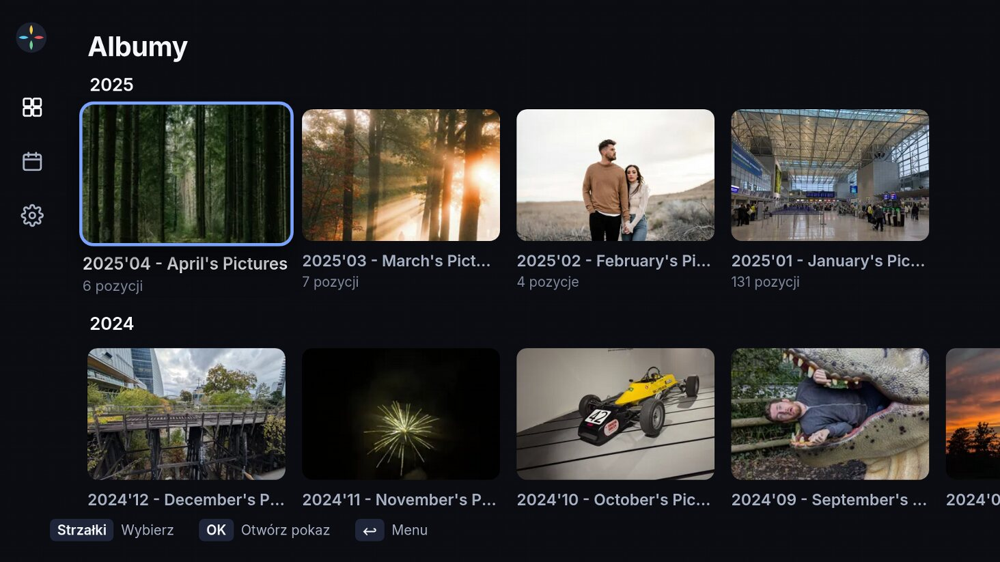
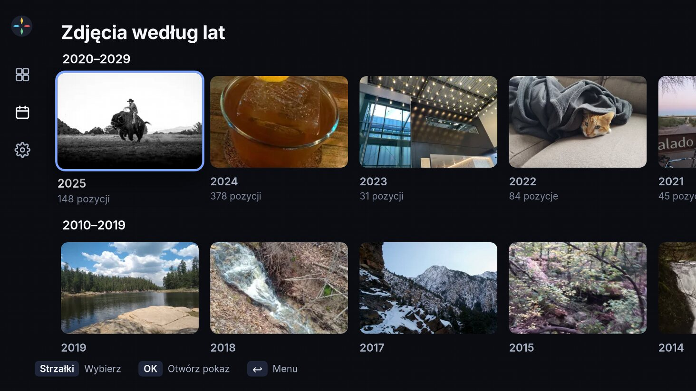
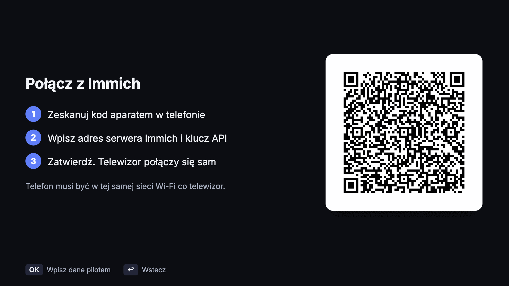

# Immich TV na telewizory Samsung (Tizen)

[](https://github.com/jurczykpawel/immich-tizen/actions/workflows/ci.yml)
[](https://github.com/jurczykpawel/immich-tizen/actions/workflows/secrets.yml)
[](LICENSE)

Przeglądaj bibliotekę ze swojego serwera [Immich](https://immich.app) na telewizorze Samsung i puszczaj pokazy zdjęć i filmów pilotem. Albumy leżą na półkach według lat, jest osobny widok „Lata” dla całej biblioteki, a telewizor skonfigurujesz z telefonu, skanując kod QR.

English version: [README.md](README.md) · Instrukcja dla agentów AI: [AGENTS.md](AGENTS.md)

| Albumy według lat | Wszystkie zdjęcia według lat |
|---|---|
|  |  |
| **Pokaz slajdów** | **Parowanie z telefonem** |
|  |  |

Zrzuty pokazują publiczną bibliotekę demo Immicha. Interfejs aplikacji jest po polsku.

> To niezależny projekt. Nie jest powiązany z projektem Immich, firmą Samsung ani Tizenem i nie jest przez nich wspierany.

## Co potrafi

- **Biblioteka w stylu Netfliksa**: boczne menu (Albumy, Lata, Ustawienia) i poziome półki. Albumy są pogrupowane według roku, w którym się zaczynają. Widok Lata grupuje wszystkie zdjęcia z biblioteki według roku i dekady.
- **Pokaz slajdów** zdjęć i filmów dla albumu albo całego roku, od najnowszych. Zdjęcie czeka ustawiony czas, film gra do końca. Pasek z nazwą albumu, datą i pozycją znika podczas odtwarzania.
- **Rozmyte tło** dla zdjęć pionowych i 4:3 zamiast czarnych pasów oraz **opcjonalne powolne przybliżanie** zdjęć poziomych.
- **Konfiguracja z telefonu przez QR**: skanujesz, wpisujesz adres serwera i klucz API na telefonie i gotowe. Dane są zaszyfrowane kluczem, który ma tylko telewizor. Można też wpisać dane pilotem, bez żadnej dodatkowej infrastruktury.
- **Zrobiona pod telewizor**: interfejs na odległość kanapy, wyraźne zaznaczenie i podpowiedzi klawiszy na każdym ekranie, przewidywalny przycisk Wstecz (na najwyższym poziomie zamyka aplikację), marginesy bezpieczne na overscan.
- **Mała**: Preact, około 70 KB JavaScriptu, wbudowany font, zero zapytań do osób trzecich.
- **Przetestowana**: testy jednostkowe na nagranych odpowiedziach Immicha, kontrola stylów pod starą przeglądarkę telewizora i test na prawdziwym telewizorze, który steruje aplikacją.

## Czego potrzebujesz

| | |
|---|---|
| Immich | v3 lub nowszy (rozwijane na 3.3 i 3.4). Aplikacja używa API v3 do zawartości albumów. |
| Telewizor | Samsung z Tizenem. **Sprawdzone na modelu z 2021 roku (Tizen 6.0, Chromium 76).** Starsze modele mają starszą przeglądarkę i prawdopodobnie nie ruszą, nowsze powinny. |
| Sieć | Telewizor musi widzieć serwer Immich (najprościej: ta sama sieć domowa). |
| Komputer | Do instalacji: macOS lub Linux z Node 22+, pnpm, Javą 17+ i narzędziami Tizen Studio (wiersz poleceń). Sprawdzone tylko na macOS (Apple Silicon). |
| Konto Samsung | Darmowe, potrzebne raz, do wystawienia certyfikatu, dzięki któremu telewizor przyjmie Twoją aplikację. |

Nie ma jej w sklepie. Budujesz ją i instalujesz na własnym telewizorze (tryb deweloperski).

## Szybki start

```bash
git clone https://github.com/jurczykpawel/immich-tizen.git
cd immich-tizen
pnpm install
pnpm test          # ponad 180 testów jednostkowych, telewizor niepotrzebny
pnpm typecheck
```

Podgląd interfejsu w przeglądarce na komputerze, w rozmiarze 1920x1080, na Twoim Immichu (serwer deweloperski przekierowuje `/api`, więc nie trzeba ustawiać CORS):

```bash
cp .env.example .env
DEV_IMMICH_TARGET=http://twoj-immich:2283 \
VITE_IMMICH_URL=http://localhost:5173 VITE_IMMICH_KEY=twoj-klucz \
pnpm dev
```

Otwórz `http://localhost:5173`. Klawisze: strzałki, Enter (OK), Backspace (Wstecz). Na telewizorze pilot działa tak samo.

## Instalacja na telewizorze

To jedyna żmudna część i robisz ją raz.

### 1. Klucz API Immicha tylko do odczytu

Immich → *Ustawienia konta* → *Klucze API* → *Nowy klucz*. Daj mu tylko uprawnienia: `album.read`, `asset.read`, `asset.view`, `timeline.read`. Nazwij go po telewizorze. Jeśli telewizor kiedyś zginie, odwołaj klucz.

### 2. Tryb deweloperski na telewizorze

1. Na telewizorze wejdź w **Apps** i wciśnij na pilocie **1 2 3 4 5** (albo na klawiaturze ekranowej).
2. Ustaw **Developer mode** na **On** i wpisz **adres IP komputera**, z którego będziesz instalować. To ma być adres, którym ten komputer dociera do telewizora. Przy kilku interfejsach (Wi-Fi i adapter Ethernet na USB, VPN) liczy się ten, przez który idzie trasa do telewizora, niekoniecznie Wi-Fi.
3. Zrestartuj telewizor (jeśli sam tryb czuwania nie wystarcza, odłącz go od prądu na kilka sekund).

Sprawdzenie z komputera: `curl http://IP_TV:8001/api/v2/` powinno zwrócić JSON z `"developerMode":"1"` i adresem Twojego komputera.

### 3. Narzędzia Tizen Studio (wiersz poleceń)

Pobierz instalator „web-cli” dla swojego systemu z `https://download.tizen.org/sdk/Installer/tizen-studio_6.1/` (`web-cli_Tizen_Studio_6.1_macos-64.bin`, `…_ubuntu-64.bin` albo `…_windows-64.exe`; sprawdzony jest ten na macOS), uruchom go i dodaj paczki dla telewizorów oraz rozszerzenie certyfikatów Samsunga:

```bash
# Potrzebna Java 17+ (macOS: brew install openjdk@17)
chmod +x web-cli_Tizen_Studio_6.1_macos-64.bin
JAVA_HOME=$(brew --prefix openjdk@17) ./web-cli_Tizen_Studio_6.1_macos-64.bin --accept-license ~/tizen-studio
~/tizen-studio/package-manager/package-manager-cli.bin install --accept-license \
  TV-SAMSUNG-Public Certificate-Manager cert-add-on
```

Rozszerzenie TV jest duże (kilka GB), więc polecenie chwilę trwa.

`cert-add-on` to *Samsung Certificate Extension*. Bez niego Certificate Manager oferuje tylko zwykły certyfikat Tizena, którego telewizor Samsunga nie przyjmie.

### 4. Certyfikat Samsung dla Twojego telewizora

Połącz się z telewizorem i odczytaj jego DUID (identyfikator urządzenia):

```bash
~/tizen-studio/tools/sdb connect IP_TV
~/tizen-studio/tools/sdb shell 0 getduid
```

Otwórz **Certificate Manager** (`~/tizen-studio/tools/certificate-manager/certificate-manager.app` na macOS) i:

1. Kliknij **+**, wybierz **Samsung**, potem **TV** i nazwij profil (w przykładach `immich-tv`).
2. Zaloguj się kontem Samsung.
3. Wystaw certyfikat **autora** i ustaw hasło (nie da się go odzyskać, trzymaj je w menedżerze haseł).
4. Wystaw certyfikat **dystrybutora** i zaznacz DUID swojego telewizora.
5. Zakończ. Sprawdź: `~/tizen-studio/tools/ide/bin/tizen security-profiles list`.

Jeśli DUID zaczyna się od `1.0#`, Samsung wymaga dodatkowego kroku przed instalacją. Opisuje go [dokumentacja certyfikatów](https://developer.samsung.com/smarttv/develop/getting-started/setting-up-sdk/creating-certificates.html).

### 5. Budowa i instalacja

```bash
TV_HOST=192.168.1.50 TIZEN_PROFILE=immich-tv pnpm deploy:tv --run
```

`tools/deploy.sh` buduje aplikację, podpisuje paczkę `.wgt`, łączy się przez `sdb` (z ponowieniami), instaluje i z `--run` uruchamia. Build bez zmiennych `VITE_*` nie niesie ze sobą ani serwera, ani klucza: aplikacja zapyta o nie przy pierwszym starcie. Skrypt odmawia budowy, gdy ustawiony jest `VITE_IMMICH_KEY` (w `.env` albo w środowisku), żeby klucz nie trafił do aplikacji przez przypadek: opróżnij go (`VITE_IMMICH_KEY= pnpm deploy:tv`) albo, dla jednorazowej wersji testowej, ustaw `ALLOW_BAKED_KEY=1`.

Zmienne skryptu: `TV_HOST` (wymagana), `TIZEN_PROFILE` (domyślnie `immich-tv`), `TIZEN_STUDIO` (domyślnie `~/tizen-studio`), `JAVA_HOME` (opcjonalna).

### 6. Połączenie aplikacji z Immichem

Przy pierwszym starcie aplikacja pokazuje ekran konfiguracji.

- **Bez żadnej dodatkowej usługi**: wciśnij **OK** na ekranie z kodem QR (jeśli build nie ma usługi parowania, od razu trafisz do formularza) i wpisz adres serwera (`192.168.1.10:2283`) oraz klucz API klawiaturą telewizora.
- **Z telefonem**: patrz [Parowanie przez QR](#parowanie-przez-qr-opcjonalne) niżej.

Połączenie zostaje w telewizorze i przeżywa ponowną instalację aplikacji. W **Ustawieniach** (ostatnia pozycja menu bocznego) zmienisz czas zdjęcia w pokazie, włączysz ruch zdjęć, sparujesz telefon ponownie albo wyczyścisz połączenie.

## Obsługa

| Klawisz | Biblioteka | Pokaz |
|---|---|---|
| Strzałki | Ruch po albumach i latach, strzałka w lewo z pierwszego kafelka otwiera menu boczne | Lewo / prawo: poprzednia / następna pozycja |
| OK | Otwiera album albo rok jako pokaz | Odtwarzanie / pauza |
| Wstecz | Zawartość → menu boczne → wyjście z aplikacji | Powrót do biblioteki |
| Play, Pause | | Start / stop |

## Parowanie przez QR (opcjonalne)

Wpisywanie długiego klucza API pilotem to męka. Usługa parowania pozwala zrobić to na telefonie. Jest opcjonalna: możesz ją pominąć i wpisywać dane ręcznie.

Jak to działa:

1. Telewizor tworzy jednorazową parę kluczy (ECDH P-256) i pokazuje kod QR z adresem małej strony, losowym identyfikatorem sesji i swoim kluczem **publicznym**.
2. Telefon otwiera stronę, wpisujesz adres Immicha i klucz API, strona szyfruje je kluczem publicznym telewizora (AES-GCM) i wysyła wynik do przekaźnika.
3. Telewizor nasłuchuje tej sesji, odszyfrowuje wiadomość, zapisuje połączenie i ładuje bibliotekę.

Przekaźnik widzi tylko szyfrogram i niczego nie przechowuje, a temat sesji to losowy 128-bitowy identyfikator. Strona i przekaźnik to jeden mały serwer Node w [`server/`](server/), bez bazy danych.

Co jest potrzebne do jego postawienia:

- Nazwa hosta, którą **telefon** widzi przez **HTTPS** (przeglądarki włączają WebCrypto tylko na stronach bezpiecznych). Może to być nazwa tylko w sieci domowej: wpis w lokalnym DNS wskazujący na maszynę w domu, z prawdziwym certyfikatem (np. Let's Encrypt z wyzwaniem DNS-01, które działa też dla nazw spoza internetu). Niektóre routery odrzucają odpowiedzi, które kierują publiczną nazwę na adres prywatny („ochrona przed DNS rebinding”). Wtedy wpisz rekord w DNS samego routera.
- Docker na tej maszynie.

```bash
pnpm build:phone                       # buduje stronę dla telefonu do dist-phone/
mkdir -p certs                         # włóż tu tvpair.crt i tvpair.key (pełny łańcuch i klucz)
docker compose up -d --build           # serwuje stronę i przekaźnik na porcie 443
```

Potem zbuduj aplikację z adresami i wgraj ją:

```bash
VITE_RELAY_URL=https://tvpair.example.com \
VITE_PAIR_PAGE_URL=https://tvpair.example.com/pair.html \
TV_HOST=192.168.1.50 pnpm deploy:tv --run
```

Pomocnicze skrypty, gdy usługa działa na zdalnej maszynie przez ssh: `PAIR_HOST=moj-serwer tools/deploy-pair.sh` kopiuje ją i uruchamia w `/opt/immich-tv-pair`, a `PAIR_HOST=moj-serwer PAIR_DOMAIN=tvpair.example.com tools/install-renewal.sh` dodaje tygodniowe zadanie cron, które odnawia certyfikat acme.sh i restartuje usługę.

Przekaźnik mówi minimalnym protokołem ntfy (`POST /<temat>`, `GET /<temat>/sse`), więc zastąpić go może serwer ntfy. Tego nie sprawdzano, przetestowany jest tylko dołączony serwer.

## Gdy coś nie działa

| Objaw | Prawdopodobna przyczyna i naprawa |
|---|---|
| `sdb connect` mówi *failed to connect* albo w logu jest *Connection reset by peer* | Adres IP wpisany w trybie deweloperskim to nie ten, którym komputer dociera do telewizora. Popraw go na telewizorze (Apps → 1 2 3 4 5) i zrestartuj telewizor. |
| `sdb` działał wczoraj, a dziś pisze *target not found* | `sdb kill-server && sdb start-server && sdb connect IP_TV`. Skrypt wdrożenia robi to sam. Telewizor musi być włączony (na `sdb` się nie budzi). |
| Instalacja kończy się bez komunikatu | W nazwie pliku paczki jest spacja (skrypt jej unika) albo certyfikat nie jest certyfikatem Samsunga z DUID Twojego telewizora. |
| `tizen package` nie znajduje profilu | `tizen security-profiles list` pokaże nazwy. Podaj właściwą w `TIZEN_PROFILE`. |
| Ekran QR nigdy się nie kończy | Telefon nie otwiera strony (inna sieć, nazwa się nie rozwiązuje, certyfikat bez zaufania) albo telewizor nie widzi przekaźnika. Otwórz adres strony ręcznie na telefonie. |
| Kafelki nachodzą na siebie albo układ jest rozjechany | Przeglądarka telewizora jest stara (Chromium 76). Jeśli zmieniałeś CSS, uruchom `pnpm test`: test wykryje funkcje nieobsługiwane na telewizorze. |
| Czarny ekran po połączeniu | Telewizor nie widzi serwera Immich albo kluczowi brakuje uprawnienia. Wejdź w *Ustawienia → Wpisz dane serwera pilotem* i sprawdź oba. |

Debugowanie na telewizorze: `sdb shell 0 debug <appId>` uruchamia aplikację z portem Chrome DevTools (tylko gdy aplikacja nie działa), a `tools/cdp.mjs` to minimalny klient. Zrzuty ekranu przez ten kanał wiszą na Tizenie, więc oglądaj DOM albo podglądaj w przeglądarce na komputerze. Po skończeniu wyjdź z aplikacji klawiszem Wstecz i uruchom ją zwykle (`tizen run -p ImmichTV01.immichtv -t <urządzenie>`). Zabicie sesji debugowania działającej aplikacji zawiesiło u mnie telewizor.

## Architektura

```
src/
  immich-client.ts      API Immicha: albumy, zdjęcia (album albo rok), lata, adresy mediów
  grouping.ts           albumy po latach, lata po dekadach, etykiety
  rows-nav.ts           ruch fokusu po półkach o różnej długości
  browse-view.tsx       menu boczne + półki (Albumy, Lata)
  show-view.tsx         pokaz (pasek informacji, postęp, tło, ruch)
  slideshow.ts          czysty reducer pokazu
  settings-view.tsx     ekran ustawień         settings-store.ts, config-store.ts   zapis
  pairing-view.tsx, manual-setup.tsx, pairing/   parowanie QR (kryptografia, klient przekaźnika, przebieg)
  app.tsx               maszyna stanów ekranów main.tsx   wejście, klawisze Tizena, wyjście
server/                 strona parowania + przekaźnik (Node, bez zależności) i jego Dockerfile
tools/                  skrypty wdrożenia, debugowania i testu na prawdziwym telewizorze
test/, test-tv/         testy jednostkowe (jsdom, nagrane dane) i testy wymagające telewizora
```

Używane endpointy Immicha: `GET /api/albums`, `POST /api/search/metadata` (zawartość albumu i cały rok, `order: desc`), `GET /api/timeline/buckets?size=MONTH` (liczba zdjęć na rok), `GET /api/assets/{id}/thumbnail?size=preview|thumbnail` i `/video/playback`. Adresy mediów niosą klucz API w `?apiKey=`, bo `` i `<video>` nie potrafią wysyłać nagłówków.

Decyzje warte znania:

- **Przeglądarka telewizora to Chromium 76** (Tizen 6.0). Bez `aspect-ratio`, `inset`, `gap` we flexie, `min()/max()/clamp()`, `?.` i `??` w kodzie wykonywanym na telewizorze. Build celuje w `chrome76`, a `test/css-compat.test.ts` pada na nieobsługiwanym CSS. Pierwsza wersja tego nie uwzględniała i na prawdziwym telewizorze układ się rozsypał.
- **Najpierw test, na nagranych danych.** Dane w `test/fixtures/` to prawdziwe odpowiedzi Immicha z zanonimizowanymi identyfikatorami i nazwami, nie ręcznie pisane obiekty. Testy nawigacji naciskają klawisze na wyrenderowanych komponentach.
- **Czysta logika jest oddzielona od widoków** (`slideshow.ts`, `rows-nav.ts`, `grouping.ts`), więc większość zachowań testuje się bez renderowania.
- **Test dymny na telewizorze** (`node tools/tv-smoke.mjs`, z ustawionym `TV_HOST`) instaluje wersję testową, steruje prawdziwą aplikacją klawiszami przez port debugowania i sprawdza m.in. rozmiary kafelków, nawigację, pokaz, odtwarzanie wideo i parowanie.

## Rozwój

```bash
pnpm test              # testy jednostkowe
pnpm typecheck
pnpm build             # aplikacja na TV -> dist/
pnpm build:phone       # strona dla telefonu -> dist-phone/
pnpm scan:secrets      # TruffleHog po historii gita (wymaga trufflehog)
TV_HOST=… pnpm test:tv # testy parowania na prawdziwym TV (potrzebne też HOST_IP, adres tego komputera)
TV_HOST=… node tools/tv-smoke.mjs
```

`pnpm install` włącza hook pre-commit (`.githooks/pre-commit`), który skanuje zmienione pliki [TruffleHogiem](https://github.com/trufflesecurity/trufflehog), także detektorem kluczy API Immicha (`.trufflehog.yaml`). CI uruchamia sprawdzanie typów, testy i buildy na Node 22 i 24 oraz skanuje całą historię pod kątem sekretów przy każdym pushu i co tydzień.

Klucze i certyfikaty nie mają czego szukać w repozytorium: `.env`, `*.p12`, `certs/` są w `.gitignore`. Zmiany są mile widziane. Najpierw napisz test i trzymaj się ograniczeń Chromium 76 opisanych wyżej.

## Bezpieczeństwo

Klucz API leży w pamięci lokalnej telewizora jawnym tekstem i pojawia się w adresach mediów. Użyj klucza tylko do odczytu, wystawionego specjalnie dla telewizora. Model zagrożeń i sposób zgłaszania problemów opisuje [SECURITY.md](SECURITY.md).

## Licencja

[MIT](LICENSE). Składniki osób trzecich (Preact, qrcode-generator, font Inter na licencji SIL OFL) wymienia [public/THIRD_PARTY_NOTICES.md](public/THIRD_PARTY_NOTICES.md).
